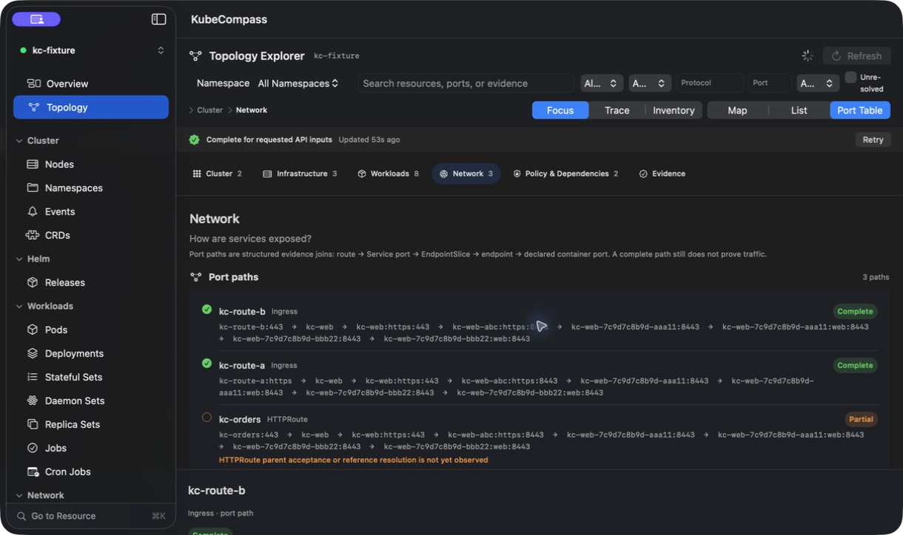

# KubeCompass

[](https://github.com/hmrdkn-labs/kubecompass/actions/workflows/stability.yml)

A native Kubernetes desktop client: SwiftUI on macOS, with a Swift +
GTK/libadwaita Linux adapter under active development.

A [Hamardikan Labs](https://github.com/hmrdkn-labs) project, derived from
[K-Dex](https://github.com/irfancen/k-dex) with its MIT provenance preserved.

## Current status

- **macOS:** the full inherited K-Dex workflow is branded as KubeCompass,
  regression-tested, and locally installable as `KubeCompass.app`.
- **Shared Swift core:** deterministic state, command, mutation-safety,
  evidence, Explorer Level, and typed Port Path contracts compile and test on
  macOS and Linux.
- **Topology Explorer:** a read-only macOS SwiftUI route builds an
  evidence-aware snapshot from allowlisted `kubectl get -o json` inputs. Six
  semantic Explorer Levels, Focus/Trace/Inventory modes, and Map/List/Port
  Table presentations expose fundamentals, health, declared routes, resolved
  ports, incomplete evidence, and assumptions without claiming packet flow.
  The current synthetic 10,000-object Release benchmark builds 94,950
  relationships in about 3.56s; interactive core queries remain below 73ms in
  that fixture. A disposable kind-cluster conformance run also passed the
  supported relationship and port cases. These are core/collector measurements,
  not GUI frame-rate or production-cluster latency claims.
- **Linux:** the independently versioned 0.2.x native GTK vertical slice is
  deliberately fixture-only.
  It demonstrates navigation, a virtualized resource table, details, states,
  confirmations, and packaging without reading kubeconfig or running kubectl.
- **`kc`:** on macOS, the installed helper opens the desktop app. A complete
  headless Kubernetes CLI is not shipped yet.

## macOS feature reference

- **Cluster browsing** — switch between kubeconfig contexts; filter by namespace.
- **Live updates** — each list is fed by a Kubernetes watch stream, so changes
  appear the moment they happen; polling only reconciles and refreshes metrics.
- **Every resource kind** — 30+ built-in kinds with kind-specific columns and
  status badges; everything else the cluster serves (aggregated APIs, any CRD)
  is discovered at connect time and reachable via the **⌘K palette**. Installed
  CRDs get their own per-API-group sidebar sections; sidebar sections and items
  are reorderable and hideable.
- **Detail inspector** — overview (metadata, containers, conditions, labels,
  secret/configmap data with reveal), live YAML, per-object events, and the
  pods of a workload or node.
- **Pod & workload logs** — streamed with follow, container picker, filtering,
  wrap/timestamps, aggregated multi-pod logs with color-coded prefixes, and
  crash awareness: a banner on crashed containers with one-click access to the
  previous instance's logs.
- **Overview dashboard** — workload status cards, recent warnings, recent
  restarts, pods running near their limits.
- **Actions** — delete, rollout restart, scale — all confirmed, with namespace
  and context named in the dialog.
- **Create & edit YAML** — per-kind creation templates and an in-app editor
  with syntax highlighting, backed by `kubectl apply`.
- **Port forwarding** — pods, services, and workloads (deployments, stateful
  sets, daemon sets, replica sets), managed from a toolbar popover.
- **Helm releases** — read directly from release Secrets (no helm CLI needed):
  chart, status, values, manifest, notes, history — values and manifest behind
  an explicit reveal, since they often contain credentials.
- **Metrics** — pod/node CPU & memory usage bars via metrics-server. Bars run
  to the limit with a tick marking the request; exact numbers on hover. When
  metrics are missing, the app says why (not installed, RBAC, unreachable
  kubelets) and shows the spec'd requests/limits dimmed instead.
- **Topology Explorer (read-only)** — move from Cluster to Infrastructure,
  Workloads, Network, Policy & Dependencies, and Evidence. Focus or trace a
  resource across Map, List, and Port Table presentations. Typed Port Paths
  retain Ingress/HTTPRoute host and path, Service port/protocol/targetPort,
  EndpointSlice address/readiness, and Pod container-port evidence. Every hop
  is Observed, Declared, Inferred, or Unavailable and explains what it proves,
  what it does not prove, and which API field produced it. Partial RBAC and
  unsupported inputs stay visible; provider-managed control-plane internals
  remain an explicit unavailable boundary. Secret and ConfigMap payloads are
  never listed for topology.
- **Direct distribution** — updater integration is disabled until a dedicated
  KubeCompass release feed exists.

## How the macOS app works

The app drives a bundled `kubectl` (or your own — path configurable in
Settings), so every auth mechanism your kubeconfig supports (EKS/GKE/AKS exec
plugins, certs, tokens) works untouched. Responses are parsed as raw JSON into
a dynamic `JSONValue` tree; kind identity is discovered from the cluster's API,
while columns and status logic are curated per kind. Lists stay current through
`kubectl get --watch` streams, with polling demoted to metrics and periodic
reconciliation.

See [ARCHITECTURE.md](ARCHITECTURE.md) for the full design and
[LIMITATIONS.md](LIMITATIONS.md) for known trade-offs.

Requirements: macOS 26+. kubectl is bundled with the app. App Sandbox is
disabled because the app must read `~/.kube` and spawn kubectl and your auth
plugins.

## Install

There is no published or notarized KubeCompass release yet. Build locally:

```sh
xcodebuild -project k-dex.xcodeproj -scheme k-dex \
  -configuration Release -destination 'platform=macOS' \
  CODE_SIGNING_ALLOWED=NO build
```

Release builds target `arm64` and `x86_64`, and must bundle a helper containing
both slices. Provide a checked universal helper with
`KUBECOMPASS_KUBECTL=/absolute/path/to/universal/kubectl`, or provide both thin
inputs with `KUBECOMPASS_KUBECTL_ARM64` and `KUBECOMPASS_KUBECTL_X86_64`.
`scripts/bundle-kubectl-macos.sh` combines and validates the inputs; the build
fails instead of silently producing an app that cannot connect on one of the
supported Macs. Debug builds may use a host-compatible helper from `PATH`, but
the build prints a host-only warning when the helper is not universal.

The reproducible CI and Xcode Cloud paths fetch official Kubernetes `kubectl`
v1.36.3 `darwin/arm64` and `darwin/amd64` binaries with pinned SHA-256
checksums, then assemble the universal helper. No Homebrew dependency is used
for release packaging.

The local `kc` helper supports `kc`, `kc path`, `kc version`, and `kc help`.
It intentionally does not masquerade as a full cluster CLI.

The locally installed GUI and TUI alternatives, their safe launch commands,
and a concrete evaluation checklist are recorded in
[docs/product/COMPARISON-LAB.md](docs/product/COMPARISON-LAB.md).

Topology Explorer's relationship vocabulary, unavailable-input behavior, and
data-safety boundary are recorded in
[docs/product/TOPOLOGY-EXPLORER.md](docs/product/TOPOLOGY-EXPLORER.md).

Tiered Port Path fixture preview:



For the Linux fixture slice, use `scripts/build-linux.sh`; the verified package
script writes an architecture-specific Debian artifact under `dist/`.

## Roadmap ideas

- Exec shell into containers
- Helm uninstall/rollback
- Multi-cluster simultaneous views
- Mac App Store edition with native cloud auth

## License

MIT — see [LICENSE](LICENSE). KubeCompass is derived from
[K-Dex](https://github.com/irfancen/k-dex); the inherited copyright and license
notice remain intact. See [UPSTREAM.md](UPSTREAM.md) for the exact baseline and
third-party distribution notes.
