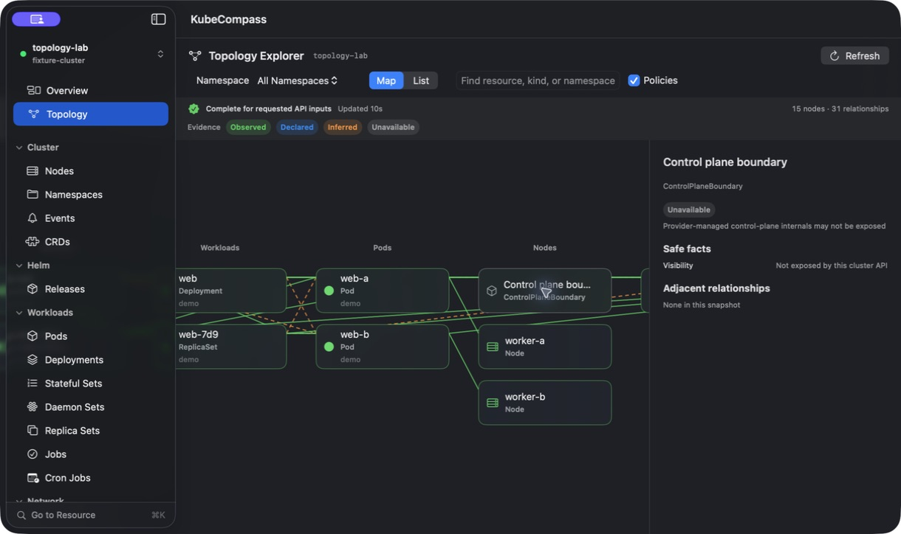
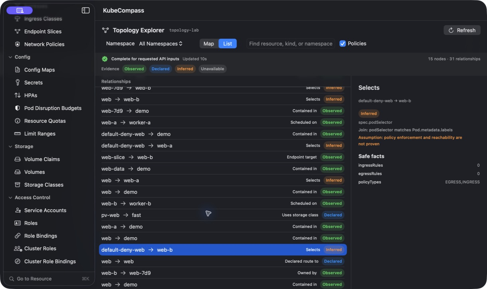
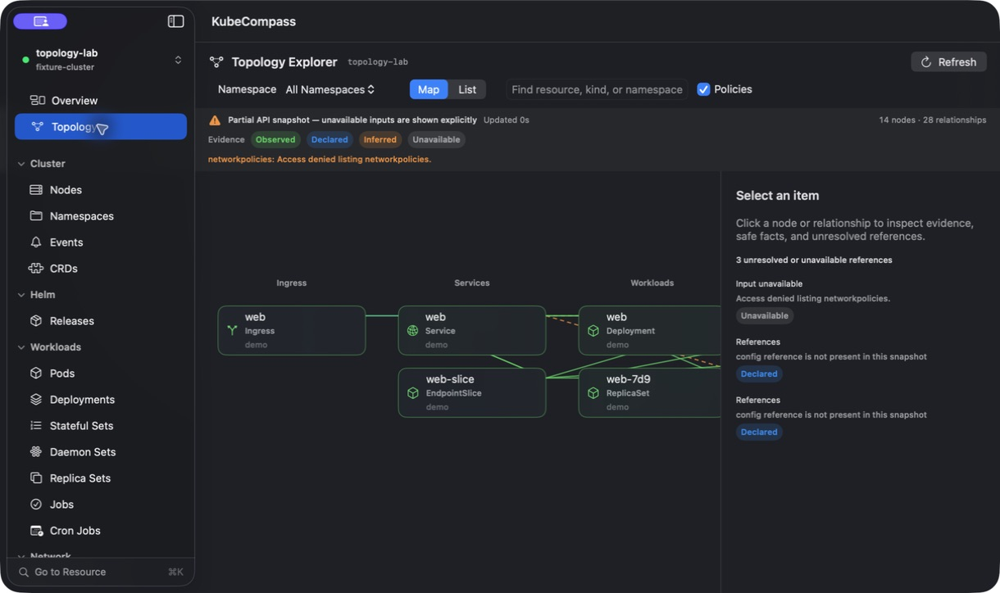

# Topology Explorer

Topology Explorer is KubeCompass's read-only learning workspace for answering
three questions:

1. What Kubernetes objects exist in this scope?
2. What explicit references or selector rules relate them?
3. Which parts of the picture are unavailable or only inferred?

It is deliberately not called a network map. Kubernetes object relationships
can explain scheduling, ownership, service selection, declared routing, policy
scope, and storage binding, but they do not prove packet flow.

## Current implementation

The macOS SwiftUI adapter now ships the first read-only Map/List slice. It
collects only allowlisted resource metadata and status through `kubectl`, then
builds the portable graph in `KubeCompassCore`. A synthetic fixture render and
keyboard review are recorded in
[`TOPOLOGY-HIERARCHY-REVIEW.json`](../interface/TOPOLOGY-HIERARCHY-REVIEW.json).
The Linux adapter can compile and test the shared graph, but it does not yet
have a GTK topology screen. No live-cluster validation is claimed.

## First useful slice

The first slice uses the current kubeconfig context and namespace scope and
builds a deterministic graph from read-only `kubectl get -o json` calls:

- Namespace containment.
- Workload owner chains, including Deployment → ReplicaSet → Pod.
- Pod placement on Kubernetes Nodes through `spec.nodeName`.
- Service selectors and their matching Pods.
- EndpointSlice ownership and ready/not-ready Pod targets.
- Ingress backends and their referenced Services, including named or numeric
  ports.
- NetworkPolicy target selection, policy types, and default-deny declarations.
- PVC → PV → StorageClass relationships.
- Pod references to ConfigMaps and Secrets by name only.
- A virtual control-plane boundary when provider internals are not exposed by
  the Kubernetes API.

The workspace is read-only. It does not delete, edit, apply, restart, scale,
exec, reveal secret values, or start port forwards.

## Evidence language

Every relationship has one of four labels:

| Label | Meaning | Example |
| --- | --- | --- |
| Observed | An explicit source field resolves to a fetched target. | A Pod's `spec.nodeName` resolves to a Node. |
| Declared | A resource spec names intent; runtime fulfillment is not proven. | An Ingress backend names a Service. |
| Inferred | KubeCompass performed a deterministic join over fetched objects. | A Service selector matches a Pod's labels. |
| Unavailable | Required input was forbidden, unsupported, offline, stale, or absent from the snapshot. | EndpointSlices could not be listed due to RBAC. |

Relationship details name the source object, source field or join rule,
resource version, snapshot time, and any assumptions. Copy must use phrases
such as “selects,” “references,” “is placed on,” and “is owned by.” It must not
say “traffic flows,” “can reach,” or “is connected” without a future telemetry
source that proves that claim.

## Surface structure

The macOS workspace uses a stable layered layout rather than an animated
force-directed graph:

- A scope bar provides namespace, layer, search, and refresh controls.
- The map groups entry routes, Services, workloads, Pods, Nodes, policy, and
  storage into readable lanes.
- Selecting a Resource Node opens a details panel with safe facts, direct
  relationships, Evidence Level badges, source fields, and unavailable input
  notices.
- A keyboard-navigable relationship list is the semantic and accessibility
  fallback for the visual map.
- Color supplements labels and line patterns; it never carries evidence alone.

Large snapshots are filtered progressively. The UI must say when a view is
truncated or partial instead of silently hiding resources.

## Required states and copy

| State | Required user-facing meaning |
| --- | --- |
| Loading | “Reading cluster topology…” and the exact context/scope remain visible. |
| Empty | “No topology resources in this scope.” Offer namespace or layer changes. |
| Partial | “Some relationships are unavailable.” List each denied/unsupported input; keep valid evidence visible. |
| Permission | “KubeCompass cannot list {kind} in {scope}.” Do not call it empty. |
| Offline | Preserve the last snapshot only with a visible stale timestamp. |
| Reconnecting | Keep selection when its UID still exists; show that refresh is pending. |
| Error | Identify the failed input and provide a read-only retry. |
| Success | Show snapshot time, context, scope, node/relationship counts, and completeness. |

## Security boundary

The portable graph accepts typed, allowlisted fields only. It never retains:

- raw Kubernetes JSON or YAML;
- annotations or arbitrary label values;
- Secret `data` / `stringData` or ConfigMap `data` / `binaryData`;
- kubeconfig content, credentials, auth-plugin output, command argv, or raw
  stderr.

ConfigMap and Secret dependencies are represented only as sanitized object
names and optional key names already present in a Pod reference. Details never
offer a reveal action.

## Known unknowns

- Managed Kubernetes providers usually do not expose control-plane machines,
  etcd placement, provider load-balancer internals, VPC routes, security
  groups, or firewall rules through the Kubernetes API.
- Node role labels and taints are evidence attached to a Node object, not proof
  of the provider's physical topology.
- A NetworkPolicy declaration is effective only when the cluster's networking
  implementation enforces it.
- A Service selector match is not proof that a request reached a Pod.
- Selectorless Services and external EndpointSlice addresses may not resolve
  to Kubernetes Resource Nodes.

These remain explicitly unavailable unless a later, separately permissioned
provider or telemetry adapter supplies evidence.

## Later layers

Later milestones may add Gateway API relationships, topology spread and
affinity, service-mesh telemetry, cloud-provider resources, and time-aware
change playback. Each needs its own evidence source and claim boundary; none is
silently inferred from the MVP graph.

## Kubernetes semantics references

- [Owners and dependents](https://kubernetes.io/docs/concepts/overview/working-with-objects/owners-dependents/)
- [Assigning Pods to Nodes](https://kubernetes.io/docs/concepts/scheduling-eviction/assign-pod-node/)
- [Services](https://kubernetes.io/docs/concepts/services-networking/service/)
- [EndpointSlices](https://kubernetes.io/docs/concepts/services-networking/endpoint-slices/)
- [Ingress](https://kubernetes.io/docs/concepts/services-networking/ingress/)
- [Network Policies](https://kubernetes.io/docs/concepts/services-networking/network-policies/)
- [Storage Classes](https://kubernetes.io/docs/concepts/storage/storage-classes/)
- [ConfigMaps](https://kubernetes.io/docs/concepts/configuration/configmap/)
- [Secrets good practices](https://kubernetes.io/docs/concepts/security/secrets-good-practices/)
